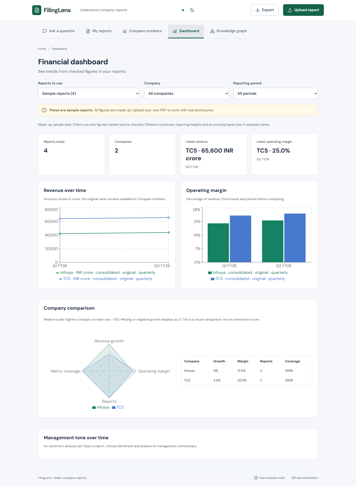

# FilingLens

**Indian Financial Filings Intelligence** — a portfolio application for asking evidence-backed questions, inspecting source pages and comparing reviewed financial metrics.

FastAPI · React + TypeScript · PostgreSQL full-text search · pgvector · MiniLM / FinBERT · PDF worker · Docker Compose

> **The included TCS and Infosys PDFs are synthetic.** Every figure and management statement in them is invented for software testing. No real issuer PDFs are redistributed. Offline answers are verbatim extracts, not generated financial analysis.

## Run the complete application

Start Docker Desktop, then run from this folder:

```powershell
if (-not (Test-Path .env)) { Copy-Item .env.example .env }
docker compose up -d --build
```

Open [http://localhost:5173](http://localhost:5173). Click **Upload report** to use your own PDF, or **Try with sample reports** to explore the four made-up examples. Wait for the report status to say **Ready**. Your uploads and sample reports are kept separate. No API key or embedding-model download is required. Fonts are bundled locally. Initial dependency/image downloads require internet access.

- Interface: [localhost:5173](http://localhost:5173)
- Interactive API: [localhost:5173/api/docs](http://localhost:5173/api/docs)
- API directly: [localhost:8000/api/docs](http://localhost:8000/api/docs)
- Readiness: [localhost:8000/api/ready](http://localhost:8000/api/ready)
- PostgreSQL: `127.0.0.1:5438`, local demo database/user `filinglens`

If `.env` already exists, retain your values. The defaults work without copying it. Ports bind to localhost. `docker compose stop` stops the app; `docker compose up -d` resumes it with the same data. Database and PDFs persist in separate named volumes. Do not remove volumes unless you intend to discard your local corpus.

## What works

- Upload digital PDFs up to 100 MB / 500 pages, with explicit company, type, reporting dates, publication date, currency, units, basis and optional official URL. The interface reads the configured limit from the API and shows selected file size.
- SHA-256 duplicate detection, retryable background jobs, page-bounded text extraction and grid-table extraction. Scanned, empty, encrypted, damaged and poorly extracted PDFs fail clearly.
- Annual-report processing removes artificial column-spacing before counting text limits, shows page progress, and keeps table chunks small enough for retrieval. Default budgets: 250,000 characters per page and 10,000,000 per report; configure `MAX_PAGE_TEXT_CHARS`, `MAX_DOCUMENT_TEXT_CHARS` and `MAX_PDF_PAGES` if needed.
- Company/type/period/publication-cutoff filtering **before** keyword, cosine-vector or reciprocal-rank-fusion retrieval. Unknown publication dates are excluded by cutoff queries.
- Extractive answers with clickable evidence, original PDF preview at the cited page, separate printed page labels and run diagnostics.
- Simple prompts such as **What is this?** identify the selected report, dates and page count, with an opening-page link. Vague prompts ask for clarification; follow-up buttons help you choose a specific question. These local overviews use saved metadata and actual source pages, without model credentials.
- Optional OpenAI-compatible embedding/generation adapters with bounded retries, timeouts, configuration fingerprints, citation-ID checks and literal supporting-quote checks.
- Source-review workflow for narrowly recognised financial candidates. Deterministic `Decimal` calculations handle lakh/crore/million conversions, revenue percentage change, margin percentage-point/basis-point changes, basis/revision/currency/duration compatibility and zero denominators.
- Simple question/report/comparison screens plus a checked-financial **Dashboard** and source-linked **Knowledge graph**. Dark mode, mobile bottom navigation and keyboard-accessible dialogs.
- A shorter upload form with drag-and-drop, a report name taken from the filename, financial-year/quarter date presets, custom dates and optional metadata. Source reviews and technical search settings remain available when needed.
- Local sentence-transformer embeddings, optional Gemini conversations, token-bounded FinBERT commentary tone, spaCy financial entities, PDF quote highlights and saved notes.
- Optional JWT accounts and per-owner access, live worker notifications over WebSockets, and PDF/Excel/CSV/Markdown exports.
- Expanded automated tests, 30-question model comparisons, fixed evaluation artifacts and GitHub Actions configuration. [Upgrade/setup guide](docs/UPGRADE_GUIDE.md).

For the complete local model setup, Gemini credentials, optional accounts and research limitations, use the [upgrade guide](docs/UPGRADE_GUIDE.md). The light default remains key-free; the ML profile installs CPU model packages and caches downloaded weights.

The app accepts additional companies and reporting periods through metadata without code changes. Document types are quarterly results, annual report, investor presentation and transcript. This describes digital text/table ingestion, not universal extraction of correct financial facts from all layouts.

## Try it

1. Select **Sample reports** under **Reports to use**, then **TCS**, both periods. Ask **What changed in operating margin between these quarters?**
2. Inspect the invented 24% and 25% inputs and the +1 percentage-point result. Click a citation and open PDF page 1.
3. Select both companies. Ask **Compare revenue growth for TCS and Infosys.** The fixture results are +2.5% and +4%.
4. In **Compare numbers**, compare TCS margins in basis points: +100 bps.
5. Ask **What is the share price?** The corpus cannot answer. Inspect harder failure cases in the evaluation report.

Full [demo walkthrough](docs/DEMO.md) · [architecture and tradeoffs](docs/ARCHITECTURE.md) · [API guide](docs/API.md) · [source provenance](docs/PROVENANCE.md).

## Evaluation: actual runs, including failures

The upgrade evaluation adds **270 actual runs** on an isolated synthetic SQLite corpus: 30 questions × 3 retrieval modes × hash, MiniLM and experimental FinBERT mean pooling. MRR/NDCG/MAP, ROUGE, measured BERTScore, numerical checks, citation metrics, abstention confusion counts, latency percentiles and bootstrap tests are recorded in [FULL_REPORT.md](evaluation/FULL_REPORT.md). MiniLM vector MRR@6 was 0.938 versus 0.905 for hash; FinBERT was 0.881. This small regression set does not establish general superiority. [Embedding comparison](evaluation/EMBEDDING_REPORT.md). A private real annual report was checked separately for model inference and source workflow.

The original PostgreSQL baseline is retained below for comparison; its figures are historical, not the new run.

The checked-in run contains **48 question runs**: 6 development + 10 initial held-out questions, each tested with all 3 retrieval modes on the same four synthetic PDFs. PostgreSQL, local 256-dimensional hash embeddings, extractive answers, k=6. The interface uses k=8 for exploratory research.

| Initial held-out metric | Keyword | Vector baseline | Hybrid |
|---|---:|---:|---:|
| Page recall@6 | 96.43% | 100% | 100% |
| Numerical cases correct | 2/3 | 3/3 | 3/3 |
| Citation IDs valid / literal quote matches | 100% / 100% | 100% / 100% | 100% / 100% |
| Appropriate abstention on unsupported questions | 2/4 | 2/4 | 2/4 |

Matching quotations do **not** prove semantic support. Forecast and cloud-segment questions expose answerability failures; keyword retrieval also misses a needed metric page in one case at k=6. Latency values, raw answers, question/PDF hashes and scoring denominators are in [the recorded report](evaluation/REPORT.md) and [raw results](evaluation/results/postgres-offline.json).

Labels were authored and inspected by the implementation agent. Independent human review is pending; no human answer-quality score or model judge is claimed. These tiny synthetic-corpus results do not establish real-filings accuracy. No paid provider calls were made; provider token usage is unavailable and cost is null without supplied pricing.

Reproduce without overwriting the baseline:

```powershell
# With the Compose database running, install the local Python environment below first.
.\.venv\Scripts\python evaluation/run.py --output evaluation/results/your-run.json
```

For a new benchmark, preserve the split before tuning. Once failures inform changes, use a new untouched question set for an independent held-out claim. [Review worksheet](evaluation/HUMAN_REVIEW.md).

## Local development

Tested host: Python 3.11.9, Node 22.19.0, npm 10.9.3. Exact transitive Python and frontend dependencies are locked. Use Python 3.11 for these locks; Python 3.14 is not supported by the pinned binary dependencies.

```powershell
python -m venv .venv
.\.venv\Scripts\python -m pip install -r backend/requirements-dev.lock
.\.venv\Scripts\python -m pip install --no-deps -e backend
Copy-Item .env.example .env
docker compose up -d db
.\.venv\Scripts\python -m app.demo
.\.venv\Scripts\python -m uvicorn app.main:app --host 127.0.0.1 --port 8000
```

In separate terminals from the repository root:

```powershell
.\.venv\Scripts\python -m app.worker
```

```powershell
cd frontend
npm ci
npm run dev
```

Choose either the complete Compose application or host development servers, to avoid port conflicts. Do not reuse the same PDF paths across a host server and container server: each deployment should own its corpus/storage location. The full Compose path was tested from fresh volumes.

For a lightweight convenience demo without PostgreSQL, omit `.env` or set `DATABASE_URL=sqlite:///./data/filinglens.db`, then run the host API/worker and `python -m app.demo`. SQLite uses a Python lexical scorer and JSON vector scan; it is not PostgreSQL FTS. PostgreSQL is the primary deployment and published evaluation backend.

## Tests and checks

```powershell
.\.venv\Scripts\python -m pytest backend/tests -q
.\.venv\Scripts\python -m ruff check backend evaluation scripts
cd frontend
npm run build
npx playwright install chromium
npm run test:e2e
```

Browser tests expect a running app with the four indexed synthetic documents. Set `DEMO_URL` to test another frontend URL. Backend tests use isolated temporary SQLite databases by default. To run PostgreSQL integration tests, create a **dedicated** database named `filinglens_test` and set `TEST_DATABASE_URL`; tests drop/recreate tables there and refuse other database-name prefixes. Never point integration tests at your research database. CI uses a disposable pgvector service.

GitHub Actions runs lint, PostgreSQL tests, a frontend build, evaluation and browser workflows. The workflow is configured but has not been run on GitHub in this local session. See [verification details and tested versions](docs/VERIFICATION.md).

## Optional provider configuration

Default `ANSWER_PROVIDER=extractive`, `EMBEDDING_PROVIDER=local` keeps all research offline. To opt into a provider, set the following in `.env` and restart the API/worker:

```dotenv
ANSWER_PROVIDER=openai
ANSWER_MODEL=your-enabled-chat-completions-model
PROVIDER_API_KEY=your-key
PROVIDER_BASE_URL=https://api.openai.com/v1
# Optionally use provider embeddings as well:
EMBEDDING_PROVIDER=openai
EMBEDDING_MODEL=text-embedding-3-small
EMBEDDING_DIMENSIONS=256
```

Model names are configurable; check your provider's supported models and JSON-output capabilities. These adapters use the documented [embeddings API](https://developers.openai.com/api/reference/resources/embeddings/methods/create) and [Chat Completions API](https://developers.openai.com/api/reference/resources/chat/subresources/completions/methods/create). Setting a provider sends the selected question/evidence or chunk text to that provider. Keep credentials in environment variables, not Git. No live provider generation is claimed as tested.

Changing embedding provider/model/dimensions requires reindexing through `POST /api/documents/{id}/reindex`; this clears fact reviews. Keyword search remains available with an old embedding configuration. Optional `INPUT_COST_PER_MILLION` and `OUTPUT_COST_PER_MILLION` values enable configured USD estimates using provider-reported usage. Supply your own verified pricing; no price is assumed by the app.

## Limitations and deployment boundary

- Unsupported questions with overlapping vocabulary can return related historical excerpts. This is a documented answerability failure, even when citation and quote checks pass. Always inspect sources.
- The lightweight default hash embeddings remain a lexical baseline; the optional ML profile provides real local MiniLM and FinBERT models. No OCR, multilingual quality guarantee or arbitrary-table fact extraction is included.
- Real uploads are not automatically trusted. Recognised candidates require review, and many real tables produce no metric candidates at all. Adjusted figures and mixed revisions need manual reconciliation; currency FX conversion is not implemented.
- The benchmark corpus is synthetic. One user-uploaded 360-page annual report was also successfully indexed and checked for source-linked extractive answers; this is a workflow check, not a real-filings accuracy benchmark. Automated downloads of the manifest PDFs returned HTTP 403; see [record](docs/real-extraction-check.json). Official URLs and manual retrieval instructions are in the [manifest](sources/official-manifest.json).
- JWT accounts, tenant scoping and role checks are available when a secret is configured. This remains a local research deployment: it needs HTTPS, distributed rate limiting, password recovery/revocation, controlled production migrations and stronger process isolation before public financial-data use.
- The queue uses a 15-minute lease, refreshed at extraction-progress checkpoints. Run one worker for this demo; indexing stages exceeding the lease and multiple workers still need stronger ownership/renewal controls.
- Future work: independently reviewed real-corpus labels, semantic claim-faithfulness assessment, stronger answerability, OCR, robust table schemas and production operational/load controls. Gemini live responses still need an API key; its integration tests use controlled responses.

Built in six initial Git milestones and staged research upgrades, with simple English commit messages. [Stages](docs/MILESTONES.md) · [Resume bullets based on observed work](docs/RESUME_BULLETS.md).

## Screenshots

Dashboard using the clearly labelled made-up sample reports:



[Question screen](docs/screenshots/research-desk.png) · [Dark mobile view](docs/screenshots/dark-mobile.png) · [Upload form](docs/screenshots/upload-simple.png)
