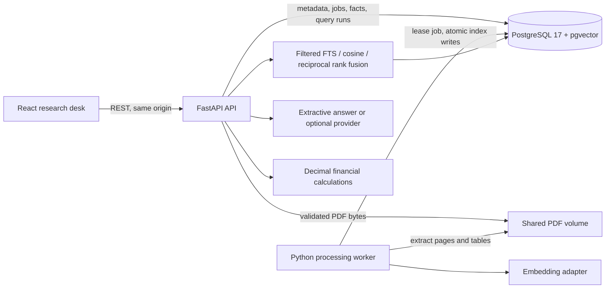

# Architecture and tradeoffs

The API persists uploads and queues work before returning HTTP 202. One worker polls jobs with `FOR UPDATE SKIP LOCKED`, a 15-minute lease and a three-attempt budget. Extraction checkpoints commit page counts/progress, refresh the worker heartbeat and extend the lease. Provider failures are retried with backoff; extraction failures require an explicit retry. A crashed worker's expired lease can be reclaimed. API startup completes schema creation before Compose starts the worker. This is a small single-worker deployment; long indexing stages and multiple workers still need stronger lease ownership/renewal controls.

Each PDF has a SHA-256 digest; a separate owner-specific key enforces deduplication without sharing document records between tenants. Storage uses the digest rather than a user filename. Document metadata lives separately from page text, chunks, table cells, reviewed financial facts, processing jobs and query-run diagnostics. Jobs commit document indexing atomically, so a failure cannot leave searchable partial evidence. Reindexing resets extracted facts and their reviews; the vector-only rebuild utility preserves them.

Sorted PDF extraction can add large amounts of horizontal whitespace to represent columns. The processor normalises this spacing while preserving line breaks, words and numbers, then applies configurable page/document text budgets. Defaults are 500 pages, 250,000 normalised characters per page and 10,000,000 per document, with a separate two-million-character raw-page guard. It never truncates over-budget text and marks it successful. Table cells remain stored separately; table retrieval chunks are bounded to 1,500 characters and candidate facts are parsed once from the full table to avoid overlap duplicates.

Extractive quotations use contiguous sentence windows. Removing intervening sentences would create a quotation absent from the source and correctly fail citation validation. The same ID and literal-quotation checks apply to extractive and generated claims.

PDF page indexes are zero-based internally. The interface displays `page_index + 1` and links with `#page=N`. A printed page label is stored separately when the PDF exposes it; we never infer a printed label from a number in extracted prose.

PostgreSQL FTS uses an English generated `tsvector` and GIN index. Natural-language glue words are removed, then remaining terms form an OR query with `ts_rank_cd`. Vector mode uses exact cosine distance over filtered rows. Hybrid combines the top 100 results of each mode with `sum(1 / (60 + rank))`. The final results keep one chunk per PDF page; matching extracted tables are preferred for metric questions. The fusion constant and retrieval limit are recorded with each answer. Exact vector search keeps the demo understandable; no approximate index is claimed.

The lightweight hash baseline uses 256-dimensional normalised lexical vectors. Optional sentence-transformers provide real local MiniLM embeddings and an explicitly experimental mean-pooled FinBERT baseline; an OpenAI-compatible embedding adapter is also available. Models are cached in memory and downloaded weights persist outside the source repository. Stored vectors carry a provider/model/dimension fingerprint; mixed configurations are rejected until vectors are rebuilt. Keyword search remains usable when the embedding configuration changes.

The offline answer is a verbatim extract, followed by deterministic calculations when two compatible reviewed facts are available. It is not generative RAG. The optional generator receives evidence as untrusted JSON and must return cited claims and literal supporting quotations. The server rejects unknown IDs and mismatched quotations. This validates traceability, not semantic entailment: a matching quotation can still fail to answer the question. A human must inspect evidence for consequential use.

Financial candidates are deliberately narrow: recognised four-column metric/value/currency/unit tables. Arbitrary annual-report tables are stored and searchable but not automatically converted into verified facts. Uploaded values require a review note; reviewed facts can carry original/restated revision status. Demo values are checked against the invented fixture specification. Comparisons use Python `Decimal` with explicit unit conversion, basis, currency, duration and revision checks. Currency conversion, adjusted-versus-reported reconciliation and arbitrary table interpretation are not implemented.

SQLite is a convenience fallback when `DATABASE_URL` is absent, with a documented Python lexical scorer and JSON vector scan. PostgreSQL is the primary deployment, CI integration target and original published evaluation backend. The new 270-run model comparison uses isolated SQLite corpora and is explicitly labelled; it does not overwrite the PostgreSQL baseline.

Schema creation includes idempotent additive migrations for existing local data and an owner-deduplication migration. A legacy SQLite migration test checks preservation. This is not a full versioned production migration framework. API and worker use the same database-owner role; production needs distinct runtime/migration roles, controlled migrations, TLS, shared rate limiting, backups and stronger document-process isolation.

## Research upgrades

Optional JWT authentication resolves a current, active database user and applies document ownership criteria to request sessions. Analysts/viewers only see their records; administrators can see all. All derived/source endpoints check document access. User-controlled fact IDs cannot bypass document scoping; event queries explicitly join visible documents across the worker/API boundary. Authentication is disabled only when the server's secret is empty, preserving the local demo. API registration establishes the first administrator and adopts existing local reports. Accounts are not provisioned automatically during installation.

Gemini generation shares the cited-claim schema and validation pipeline with the existing optional generator. A model confidence below 0.5 causes abstention; confidence is explicitly uncalibrated. A conversation stores user/assistant messages, source IDs and complete answer responses, loads at most five recent messages, and rejects source-filter changes in a continuing session. History is context, never evidence. Sensitive questions/passages are stored for the requested history/export feature, not written into request logs.

Separate analysis tasks run FinBERT commentary sentiment and spaCy financial entities in the worker when enabled. Sentiment respects a 512-token maximum including special tokens and uses token-weighted aggregation. A conservative heading heuristic provides page-level sections; it does not promise complete management-discussion segmentation. Entity relationships are labelled sentence co-occurrence, with source-offset mentions. Neither entity detections nor sentiment scores become checked financial facts.

Worker and upload transactions write durable status events. `/api/ws` reads this outbox and emits scoped progress to the browser, with authenticated first-frame tokens and a heartbeat. Reconnects refresh current state; the browser retains a 60-second recovery refresh. An in-memory connection manager groups sockets, while durable events solve the separate-process worker problem. There is no Redis or false claim of direct in-process worker broadcasting.

React-PDF renders source pages with escaped custom text markup and cross-item quotation highlighting. The bundled PDF.js worker version is pinned to React-PDF's own version and nginx serves `.mjs` as JavaScript. An explicit non-suspending failure path uses the standard viewer. Notes quote actual page text and remain separate database annotations. Charts use only checked facts, keep incompatible series separate and expose original values in comparison/source views. Export scopes documents and saved answers before generating CSV, Markdown, PDF or Excel, including guarded text cells and application-built calculation formulas.

See [UPGRADE_GUIDE.md](UPGRADE_GUIDE.md) for model setup, research limits and deployment assumptions.
