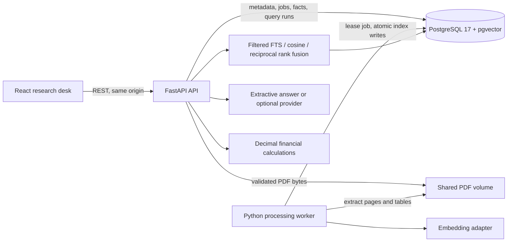

# Architecture and tradeoffs

The API persists uploads and queues work. One worker polls jobs with `FOR UPDATE SKIP LOCKED`, a 15-minute lease and a three-attempt budget. Provider failures are retried with backoff; extraction failures require an explicit retry. A crashed worker's expired lease can be reclaimed. API startup completes schema creation before Compose starts the worker. This is a small single-worker deployment; long jobs exceeding the lease need a lease-renewal design before scaling workers.

Each PDF has a SHA-256 unique key. Storage uses that digest rather than a user filename. Document metadata lives separately from page text, chunks, table cells, reviewed financial facts, processing jobs and query-run diagnostics. Jobs commit document indexing atomically, so a failure cannot leave searchable partial evidence. Reindexing resets extracted facts and their reviews.

PDF page indexes are zero-based internally. The interface displays `page_index + 1` and links with `#page=N`. A printed page label is stored separately when the PDF exposes it; we never infer a printed label from a number in extracted prose.

PostgreSQL FTS uses an English generated `tsvector` and GIN index. Natural-language glue words are removed, then remaining terms form an OR query with `ts_rank_cd`. Vector mode uses exact cosine distance over filtered rows. Hybrid combines the top 100 results of each mode with `sum(1 / (60 + rank))`. The final results keep one chunk per PDF page; matching extracted tables are preferred for metric questions. The fusion constant and retrieval limit are recorded with each answer. Exact vector search keeps the demo understandable; no approximate index is claimed.

Local embeddings hash words deterministically into a 256-dimensional normalised vector. They need no model download but do not understand semantic paraphrases. An optional OpenAI-compatible adapter supports configurable model and dimension settings. Stored vectors carry a provider/model/dimension fingerprint; mixed configurations are rejected until reindexing. Keyword search remains usable when the embedding configuration changes.

The offline answer is a verbatim extract, followed by deterministic calculations when two compatible reviewed facts are available. It is not generative RAG. The optional generator receives evidence as untrusted JSON and must return cited claims and literal supporting quotations. The server rejects unknown IDs and mismatched quotations. This validates traceability, not semantic entailment: a matching quotation can still fail to answer the question. A human must inspect evidence for consequential use.

Financial candidates are deliberately narrow: recognised four-column metric/value/currency/unit tables. Arbitrary annual-report tables are stored and searchable but not automatically converted into verified facts. Uploaded values require a review note; reviewed facts can carry original/restated revision status. Demo values are checked against the invented fixture specification. Comparisons use Python `Decimal` with explicit unit conversion, basis, currency, duration and revision checks. Currency conversion, adjusted-versus-reported reconciliation and arbitrary table interpretation are not implemented.

SQLite is a convenience fallback when `DATABASE_URL` is absent, with a documented Python lexical scorer and JSON vector scan. PostgreSQL is the primary deployment, CI integration target and published evaluation backend. SQLite results are not represented as PostgreSQL FTS measurements.

Schema creation is idempotent for a fresh local install. There is no production migration framework yet. API and worker use the same database owner role in this local demo; production needs distinct runtime/migration roles, migrations, authentication, authorisation, TLS, rate limiting, backups and stronger document-process isolation.
